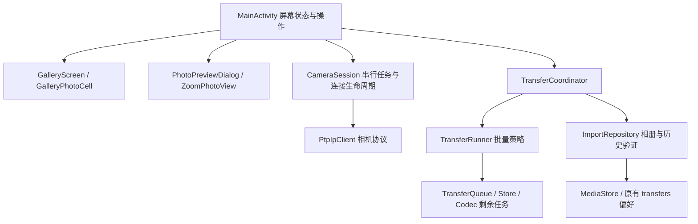

# 架构与开发边界

当前为单模块原生 Android 应用，采用渐进拆分，不改动 PTP 线协议与既有导入记录格式。

- 协议操作仍在一个执行器中串行运行；图片解码使用独立执行器。
- CameraSession 统一拥有连接、网络与执行器；Activity 销毁仍会关闭会话，因此不具备后台下载生命周期。
- ImportRepository 只有在长度匹配、文件发布成功后才记录成功；查询状态同时验证记录和文件。高清缓存不作为已导入证据。
- TransferRunner 只负责任务顺序与恢复策略，便于不依赖 Android 的单元测试。失败项和后续项保留；已完成项移除并同步落盘。
- 重试为用户发起，要求原相机身份匹配；逐张核对照片元数据，跳过可靠存在的文件，不自动处理句柄变化。
- 同步任务存储与相册发布不是跨系统事务。发布与历史落盘之间存在极短中断窗口；无法确认时不会误标，可能要求用户核对副本。
- MainActivity 仍包含自动连接策略、图片加载及状态渲染，不是完全无业务的视图层。后续引入后台服务时应迁移会话/任务所有权，而不是再复制一套下载逻辑。

本次未新增后台服务、跨进程续传或传输偏移恢复。
