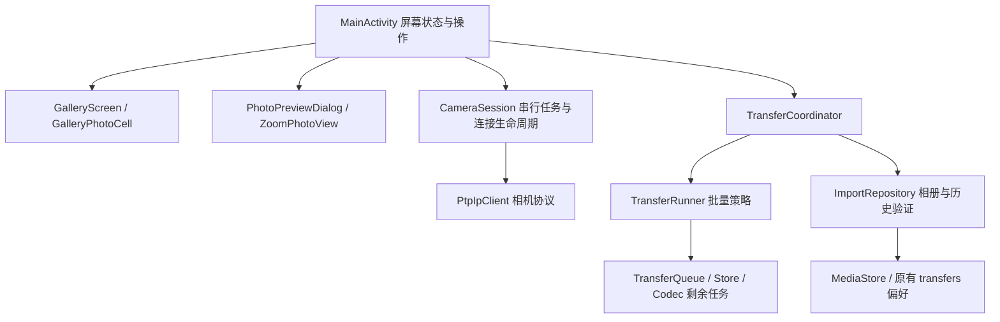

# 架构与开发边界

当前为单模块原生 Android 应用，采用渐进拆分，不改动 PTP 线协议与既有导入记录格式。

- 协议操作仍在一个执行器中串行运行；图片解码使用独立执行器。
- CameraSession 统一拥有连接、网络与执行器；Activity 销毁仍会关闭会话，因此不具备后台下载生命周期。
- ImportRepository 只有在长度匹配、文件发布成功后才记录成功；查询状态同时验证记录和文件。高清缓存不作为已导入证据。
- TransferRunner 只负责任务顺序与恢复策略，便于不依赖 Android 的单元测试。失败项和后续项保留；已完成项移除并同步落盘。
- 重试为用户发起，要求原相机身份匹配；逐张核对照片元数据，跳过可靠存在的文件，不自动处理句柄变化。
- 同步任务存储与相册发布不是跨系统事务。发布与历史落盘之间存在极短中断窗口；无法确认时不会误标，可能要求用户核对副本。
- MainActivity 仍包含自动连接策略、图片加载及状态渲染，不是完全无业务的视图层。后续引入后台服务时应迁移会话/任务所有权，而不是再复制一套下载逻辑。

本次未新增后台服务、跨进程续传或传输偏移恢复。

## 0.5.0 生命周期更新

CameraConnectionService 使用 connectedDevice 前台服务，独立于 MainActivity。TransferApplication 持有 ConnectionRuntime，统一管理 CameraWifi、CameraSession、相机身份、图库缓存、导入仓库和批量任务。Activity 的销毁只取消界面订阅及图像解码，不再关闭协议执行器或相机网络。

ConnectionLifetime 单独记录用户的连接意图和重连退避；意外失联可以恢复，手动停止不可被迟到的网络回调重新开启。前台服务通知与图库订阅同一状态源，停止动作也共享 runtime.stop。后台任务不持有 Activity。高清预览属于页面发起的临时任务，完成前可能短暂保留其回调，销毁页面后的回调不更新界面。

服务为 START_NOT_STICKY，不绕过用户或系统的停止操作。进程死亡后仅保留落盘的剩余传输任务，重新连接后由用户重试。本节替代前述“Activity 销毁会关闭会话”的旧版描述。
