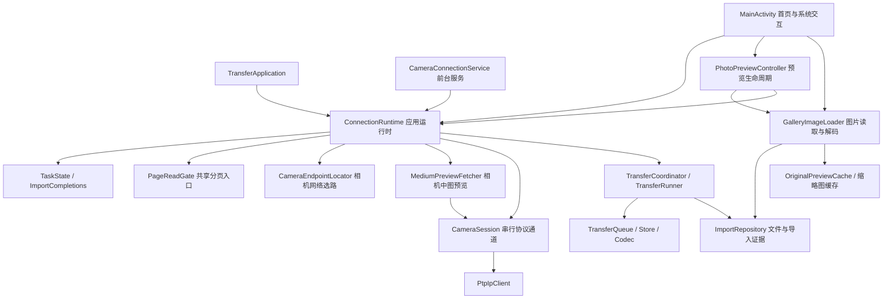

# 架构与开发边界

当前版本为 0.5.14，采用单模块原生 Android 与渐进拆分。保持 PTP 线协议、应用标识、相册路径、既有导入记录和任务存储格式。

## 职责与所有权

| 部件 | 负责 | 边界 |
|---|---|---|
| MainActivity | 首页渲染、多选、权限和系统设置、重复导入选择 | 不解码图片、不清空共享完成事件、不直接改已导入状态 |
| PhotoPreviewController | 预览窗口、前后导航、原图确认、缩放图片展示与页面回调有效性 | 不拥有相机连接，关闭页面不停止后台导入 |
| GalleryImageLoader | 内存缩略图命中、异步磁盘读取、解码、清晰预览来源选择和缓存 | 页面拥有独立解码执行器；相机请求委托运行时，不访问相册写入接口 |
| ConnectionRuntime | 重连协调、图库数据、任务状态、分页准入、导入证据更新 | 应用级存在；照片与导入集合对界面只读；任务与连接不引用 Activity 作为所有者 |
| CameraConnectionService | 前台通知、CPU/Wi-Fi 锁、显式停止入口 | START_NOT_STICKY；不绕过用户和系统停止 |
| CameraEndpointLocator | 在物理 Wi-Fi 网络中选出相机热点与地址，读取 SSID | 只读系统网络状态；不探测普通 Wi-Fi 和 VPN；不持有连接 |
| MediumPreviewFetcher | 通过 CameraSession 读取相机内置中图并写入缓存 | 与其他协议操作共用串行通道；失败后由 CameraSession 判断是否保留连接 |
| CameraSession | PTP 客户端、物理网络、串行执行器与任务准入锁 | 协议操作保持串行；断开通过 abort 解除阻塞 |
| TransferRunner / Coordinator | 逐张保存、跳过可靠存在的照片、剩余任务持久化与重试 | 不依赖预览窗口，协议调用及相册保存仍走既有实现 |
| ImportRepository | MediaStore 发布、保存原有记录、验证文件仍存在且大小匹配 | 缓存从不作为已导入证据 |

## 状态与线程规则

- TaskState 是不可变任务快照，包含操作类型和可选的单张导入进度；首页、预览按钮和前台通知读取同一来源。CameraSession 的原子锁仍用于任务准入，完成时在主线程一起发布空闲状态，避免任务已释放但旧完成通知尚未处理时进入下一任务。
- 图库集合和界面状态在主线程通知观察者；协议与相册 I/O 在运行时串行执行器，图片解码在 GalleryImageLoader 的独立执行器。UI 缩略图入口只同步读内存，磁盘未命中异步读取并合并重复请求。
- 导入完成事件有递增序号。每个观察者记录自己的读取位置；读取不消耗其他观察者的结果。同一批次内事件有界，下一批清理旧事件但不回退序号。成功与可靠跳过均取消对应选择，未完成项保留。
- 预览加载使用页面代次、连接会话标识和关闭标记判断结果是否仍有效。切图、关闭窗口或销毁 Activity 后，迟到图片不会覆盖新页面。刷新进度、选择和分页列表不调用主图重新加载，不重置缩放。
- 首页网格与横向缩略图栏只判断滚动接近尾部，统一通过 PageReadGate 以“会话 + 对象游标”防止重复请求。忙碌、断开和末页不准入；新手势允许失败后再试，手动继续读取保留。单批仍读取最多 40 个相机对象，仅 JPEG 进入图库。

## 保存、恢复与兼容

- 导入仍保存至 Pictures/ZfTransfer。既有 transfers 偏好及 saved_ 键计算规则不变，导入记录与手机中可读、已发布、长度匹配的 JPEG 共同构成导入证据。
- 清晰预览与临时原图使用独立缓存目录和预算，原图临时文件完整后原子发布；不会创建相册导入记录。
- 重试是逐张重试，要求原相机身份及对象元数据匹配；不是字节偏移续传。进程重启后可恢复剩余任务，由用户连接并继续。
- 相册发布和偏好记录不是跨系统事务。极短中断窗口可能留下已发布但无记录的文件；无法确认时不误标，可能出现需用户核对的副本。
- Activity 销毁只解除界面订阅、关闭预览和解码执行器，不关闭应用级协议通道。页面发起的在途预览可能暂时保留回调，但销毁后的回调不更新页面。

## 验证边界与后续方向

后续开发顺序、每项的现状与验证方式见 [后续开发计划](后续开发计划.md)。

本轮新增任务显示、分页准入及多观察者完成事件的纯逻辑回归测试。编译和单元测试不能替代实机的预览切换、多选、重复导入、批量传输、断线恢复及后台保活验收。

MainActivity 仍负责设置与导入确认，ConnectionRuntime 仍是连接策略协调入口。当前不引入多模块、依赖注入框架或 Compose；待设置、传输队列独立成页或支持多相机时，再按实际边界继续拆分。

0.5.7后续实机回归已覆盖预览、导航、多选、两处自动读取、单张与两张批量原图、重复导入、按钮进度和短时后台/熄屏心跳，详见开发记录。故障注入及长时保活仍不在本轮验收范围。

## 0.5.8 界面与筛选边界

AppUi、AppSheet与ProgressActionButton统一原生页面与弹窗样式。PhotoCatalog提供纯逻辑筛选及预览列表追加策略；MainActivity仅对筛选结果做列表与范围选择，其他筛选的选择单独保留。预览冻结已有成员以避免导入后跳图，新的匹配照片追加到末尾。

网格使用稳定照片ID打开预览，勾选触摸区单独消费，防止重排或图片更新时误入预览；自动分页仅由实际浏览手势准入，切换筛选时重置浏览手势。缩略图栏在列表已到尾部、无法继续滚动时，也允许通过向后滑动请求下一批。

所有变化限于呈现与筛选策略，PTP协议、原图相册发布及导入记录格式不变。

已导入标签现由LocalImportGallery在首页共用网格内读取手机的成功下载记录与现存文件；不依赖ConnectionRuntime.photos，不申请相机分页。相机目录的已导入标记仍由原ImportRepository核验。文件查询及采样解码在页面独立后台线程执行，UI只处理内存缩略图；失效文件不进入目录。历史安装遗留目录经用户授权只读展示，独立于相机导入证据。新导入追加逐文件URI记录，同时保留原有每相机对象的记录键。

## 新照片自动导入（0.5.14）

AutoImport 是纯逻辑：给定当前目录、连接时的基线句柄集合和“是否已导入”的判断，返回待下载的 JPEG，按拍摄顺序排列，两张卡上的备份副本只取一份。ConnectionRuntime 在首次目录读取时记录基线，之后每次刷新目录若开关打开且相机空闲，就把结果交给既有的导入流程，已导入标记、跳过已导入和进度提示都沿用手动导入。待下载列表每次刷新重新计算，所以没取成功的照片下次还会出现。

应用在前台时窗口常亮，新照片的检查也只在前台执行，因此锁屏或退到后台时不会下载，回到应用后补下。这一行为只有代码依据，没有实机测试，详见后续开发计划。
